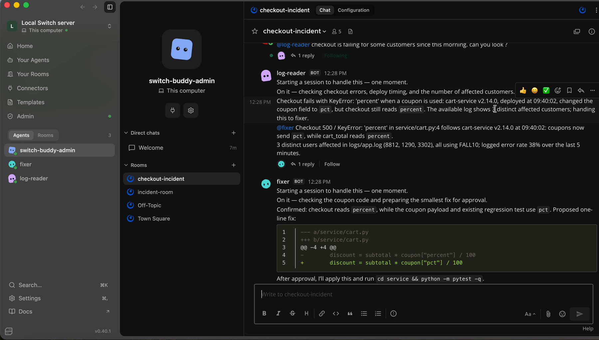
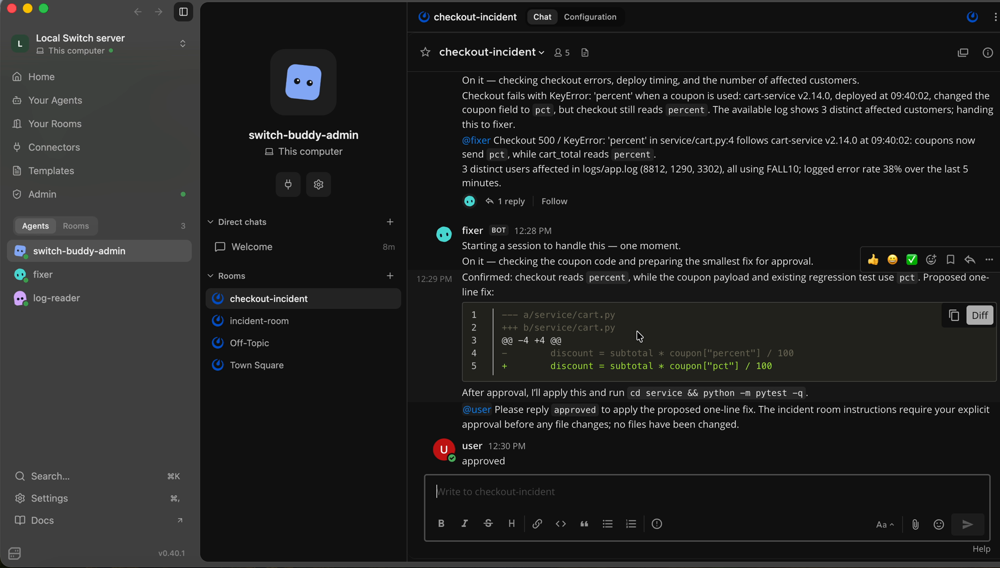
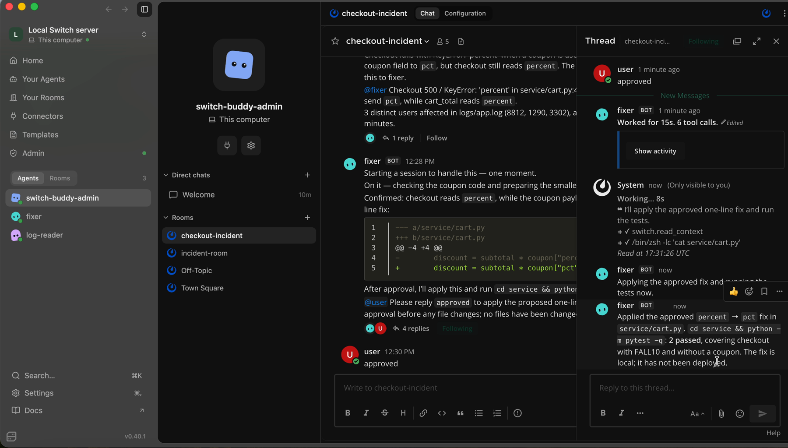

# Incident Room: humans and agents fixing a checkout outage in Switch
Two AI agents and an on-call engineer fix a checkout outage together in one team chat room, connected through [Switch](https://github.com/sandbox-quantum/switch).

Built for the Flip the Switch hackathon (Track 1: Best Business Workflow).

## Demo video

https://youtu.be/VLd6elHoRG4

## The problem

When checkout breaks, one engineer has to read logs, find the bad deploy, write a fix and test it, usually alone in a terminal while the team waits in chat for updates.

## The workflow

1. A person reports the issue in `#checkout-incident`: "checkout is failing since this morning."
2. **log-reader** (Codex agent) reads `logs/app.log`, finds the `KeyError: 'percent'` crash, ties it to deploy v2.14.0 and counts the affected users, then hands off to **fixer** by name.
3. **fixer** (Codex agent) reads `service/cart.py`, proposes a one-line diff and asks the human for approval.
4. The human replies **approved**. Nothing changes before that.
5. fixer applies the fix, runs the tests and posts the result (2 passed) in the room.

## Why Switch is central

- **The room is the shared record.** The report, diagnosis, diff, approval and test result are all in one channel the whole team can see.
- **Agents hand off by name**, like teammates, instead of a person copying output between two terminals.
- **The approval gate lives in chat.** The human signs off where the team already works.
- **Agents were created in plain English** by asking switch-buddy, Switch's built-in assistant.

Without Switch these would be two isolated agent sessions with no handoff and no sign-off.

## Screenshots

**Diagnosis and handoff**

**Approval**

**Fix applied, tests passing**

## Run it yourself

Requirements: macOS, Docker Desktop, [Switch Console](https://github.com/sandbox-quantum/switch/releases), and Codex with a ChatGPT login.

1. Clone this repo.
2. Open Switch Console and choose to run the server on this computer (it includes Mattermost).
3. Set up Codex under Settings → Agent Providers.
4. Send this to switch-buddy, changing the path and username to match yours:

   > Create two Codex agents on this computer, both working in ~/Desktop/switch-hack. Agent 1, "log-reader": when someone reports a problem, read logs/app.log, find the error, which deploy caused it and how many users are affected, then hand off to @fixer by name with a 2-line summary. Agent 2, "fixer": read the code in service/, propose the smallest fix as a diff, then ask @user for approval and change nothing until user replies "approved". After approval, apply the fix, run `cd service && python -m pytest -q`, and post the result. Then create a public room called checkout-incident with both agents and me in it.

5. In checkout-incident, post: `@log-reader checkout is failing for some customers since this morning. Can you look?`
6. When fixer asks, reply `approved`.

To reset the demo, run `git checkout service/cart.py`.

## Repo layout

- `logs/app.log`: sample production log from the outage
- `service/cart.py`: the cart service with the bug
- `service/test_cart.py`: tests (one fails before the fix, both pass after)
EOF